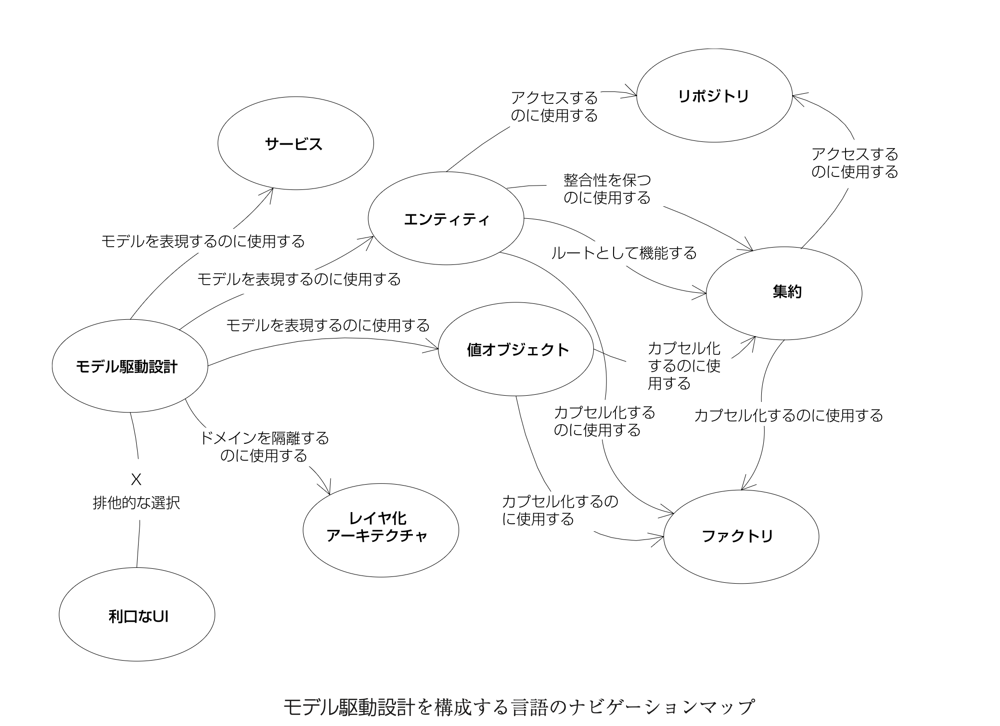
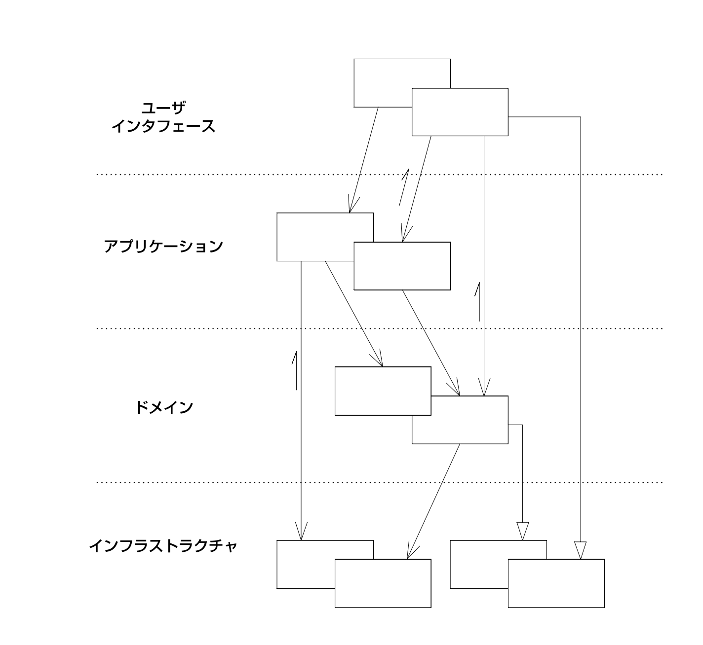

# 書籍
[エリック・エヴァンスのドメイン駆動設計](https://www.seshop.com/product/detail/20690)

# まえがき 
## 3つ対照的なプロジェクト
- 事例その1: **第二バージョンを仕上げられずに、泥沼にハマっていった**
  - ドメインモデルを構築せず、共通の言語もなく、構造化されていない設計を抱え込んだプロジェクト
  - 一番の問題だったのは、ビジネスロジック
- 事例その2: **最初の成果が出たあとも継続的に開発が加速した**
  - ドメイン設計を重視していた
  - ユーザーの要求に対し、柔軟性と拡張能力を持って対応できた
  - ドメインエキスパートと開発者の間でも、コミュニケーションの質が向上した
  - 鋭いドメイン設計のおかけげで、保守の負担は容易になった
- 事例その3: **高尚な志をもった割には目標を低くし、ありふれた形に落ち着いた**
  - モデルを最重要視していた
  - 適切なツールを使用し、ビジネスのこを十分に理解していた
  - 開発者の役割を謝って分割してしまい、モデリング実装から切り離されてしまい、進行中の深い分析が設計に反映されなかった

### 考察・感想・まとめ
- ドメインモデルを構築し、共通の言語もないようなプロジェクトは泥沼にハマるよ
- どれだけモデルを重要視しても、それをアプリケーション実装に繋げる必要があり、開発者はそれをするだけの経験とそこから導かれる設計の型や判断基準、作法が必要だよ

## 複雑さという課題
- ソフトウェアがどこまで複雑になれるかの主な要因は、設計。
- 最も重要な複雑さは、技術的なものではない。（もちろん、技術的なものでも設計に影響を与えはするが）
  - 複雑なのは、ドメインそのもの（= ユーザーの活動やビジネス）

### 考察・感想・まとめ
- 複雑なのは、ユーザーの活動やビジネス（= ドメインそのもの）
- ドメインの複雑さを、設計で扱わなければならない
- 設計を成功させるには、ドメインの複雑さを設計で扱わなければならない、という側面を体系的に扱わなければならない。

## 設計対開発プロセス
- よく、設計とプロセスは切り離されて扱われる（それぞれが複雑なため）が、エヴァンスは設計とプロセスは切り離せないと考えている
- DDDの前提として、
  - 開発がイテレーティブであること
  - 開発者がドメインエキスパートと密接に関わっていること

## ドメイン駆動チーム
- **本書から最大の収穫が得られるのは、チームが一致団結してドメイン駆動設計アプローチを適用し、ドメインモデルがプロジェクトで交わされる会話の中心に持ってきた時である**

# 第1部 ドメインモデルを機能させる
ドメイン駆動設計の基本的な目標を紹介する
コミュニケーションと設計を推進するためにドメインモデルを使用するということがどういう意味を持つのかを概観する

- モデルとは何か
  - つまり、簡素化である
  - 当面の問題を解決する上で関連する側面を抽象化し、それ以外の詳細を無視することで行われた、現実に対する1つの解釈
- 開発チームはユーザーの活動に関する体系化された知識を身につけていかなければならない
  - モデルはドメインの複雑さと格闘するためのツール
- ドメインモデルとは
  - 特定の図ではなく、図が伝えようとしている考え方。
  - ドメインエキスパートの頭の中にある知識だけではなく、それが厳密に構成され、選び抜かれて抽象化されたもの
- ドメインモデリングとは
  - モデルをできる限り「写実的に」作成することではない
  - 映画制作に近い。
    - ある目的に沿って、現実の概要を表現している。
    - 映画制作でも未編集の素材をそのまま使うことはしないし、必要な側面のみを切り取って使う

## 第1章 知識を噛み砕く
- ドメインモデルを作っていく過程で、開発者はそのドメインにおける知識が身につき始め、ドメインエキスパートも学び、モデルを成長させていった
  - ブレインストーミングを行ってはモデルを改良し、質問してはそれに対して説明してもらった
  - ドメインに対する開発者の理解が増し、問題解決においてモデルがどのような役割を果たすのかドメインエキスパートが理解していくにつれて、モデルは成長した
- エヴァンスが具体的なPoCを作ったことによって、モデルが何を意味し、実際に機能するソフトウェアにどう関係しているかを、ドメインエキスパートがより明確に理解できるようになった
  - これにより、議論がより活発になった
    - 上記のように、ドメインエキスパートがモデルの役割を理解したこと、PoCを実際に見せたことで具体的な評価やFBができるようになったことが要因として考えられる
↓
これによって、ドメインエキスパートと円滑にコミュニケーションをしたりするためのフレームワークができていた

### 効果的なモデリングの要素
1. **モデルと実装を結びつける**
  - 荒くてもPoCを作って実際にドメインエキスパートに見せることによって、モデルと実装の結びつきが早い時期に作り出された
2. **モデルに基づいて言語を洗練させる**
  - ドメインエキスパート・開発者など参画メンバー全員が、モデルで使用されている言語を用いて議論するようになった
    - これによって、意訳なしでコミュニケーションを取ることができるようになった
3. **知識豊富なモデルを開発する**
  - モデルを単なるデータスキーマとして捉えるのではなく、そのオブジェクトの持つルールや振る舞いを表現する
4. **モデルを蒸留する**
  - モデル開発を進めていくにつれて、必要な知識とそうでない知識を取捨選択するようになり、常にモデルが本質的な概念のみを表現するようにしていった
5. **ブレインストーミングと実験を行う**
  - 仮説（モデル案）立てて、図や言葉やコードで試し、ダメなら別案を立てて試す

#### まとめ・考察・感想
- ドメインモデルを使って、共通の言語を用いながら、インタラクティブな会話によってモデルを蒸留する
- 素早く動きだけでもドメインエキスパートに見せる（PoCを作る）こと、素早くフィードバックをもらうことができるし、それによってモデルと実装の結びつきが早期に作りだせる

### 知識のかみ砕き
- 知識をかみ砕くとは
  - 大量の知識・情報をふるいにかけて、まとめて、大部分の意味を理解できるシンプルな見方を見つけること
  - 色々な情報をまとめてシンプルに説明できる概念が、今取り組んでいる問題のシナリオを矛盾なく説明することができるのであれば成功
    - これをエヴァンスは「蒸留」と表現している
- 知識のかみ砕きは一人で行う作業ではなく、開発者とドメインエキスパートが共同で行うものであり、大抵は開発者が率いる
- 旧来のウォーターフォール手法がうまくいかない理由
  - フィードバックが完全に欠けているため
- イテレーティブな開発を行っているのに抽象化を行っていないせいで、知識の積み重ねに失敗しているプロジェクトもある
- **ドメインエキスパートと共同でモデルを育てるのは、ソフトウェアをドメインエキスパートの考え方と深く結びつけるため**
  - 開発者がドメインモデルを改良しようとすると、必然的にドメイン知識が必要になりキャッチアップするようになる
  - ドメインエキスパートは自分の知識を抽出して本質を説明することを強いられることによって、自分の知識が精密になる

#### まとめ・考察・感想
- 知識をかみ砕くとは、蒸留するということ
  - ドメインエキスパートと共同で、重要なものとそうでないものを取捨選択し、今取り組んでいる問題のシナリオを矛盾なく説明できるか検証する

### 継続的学習
- 前提として、ソフトウェアを書き始める時、我々はそのドメイン領域のことを十分に理解しているわけではない
  - 人もドキュメントも散財しているし関係ないものとも混ざっているので、どの知識が必要なのかさえわからない
  - 自分たちはどれほど理解していないのかを理解していない
    - これによって誤った想定をしてしまう
- 全てのプロジェクトから知識は流出している
  - 典型的な設計アプローチの場合、コードとドキュメントは苦労して手に入れた知識を使える形式で表現しない
    →口頭での伝承が途切れたら知識は失われてしまう
- 高度に生産的なチーム
  - 継続的学習を実践している
    - 学習の対象
      - 技術的な知識
      - ドメイン知識
- エヴァンスがPCB設計についてドメインエキスパートとの会話で学んだこと
  - アプリケーションに関係する重要な概念を理解し、構築している内容が正しいかどうかのチェックを行うこと
  - 実際にエヴァンスはこの時、作ろうとしていた機能が重要でないことを理解し、結局開発しないことになった
    - アプリケーションのコアは別にあることがわかったため、それを中心に持ってくるようモデルが変更された
      →ドメインエキスパートがより多くのことを学んだため、アプリケーションの目標が明確になった

#### まとめ・考察・感想
- 技術的な知識だけではなく、今解決しようとしているドメインの知識も意識的にチームで継続的に学習しなければならない

### 知識豊富な設計
- モデルによって捉えられる知識は「名詞を見つけること」には留まらない
  - ビジネス活動のルールもそう
  - エンティティや値があるが、それに関連したビジネス的な活動はどんなものか？そのルールは？という感じで深ぼっていく
    - この時に、知識のかみ砕きという手法が真価を発揮する
      - なぜなら、複数のビジネスルールに矛盾があるかもしれないから
      - 前提: 
        - 通常、ドメインエキスパートは自分の頭の中では、自身の常識や経験からこれらの矛盾を調整している
        - だが、ソフトウェアはその性質から、矛盾を許容できない
- ビジネスルールを、ドメイン知識として名前のついたオブジェクトに切り出すことで、それはこのドメインにおけるルールなのだとビジネス側も巻き込んで理解できるようにする
  - 一般的な設計（ストラテジーのポリシー）を使うときは、差し替え可能となるようルールを別オブジェクトに切り出すが、この文脈における切り出す理由は「複数のルールが存在しうるため、イテレーションの途中で差し替えることができるようにするため」
  - しかし、エヴァンスが用いた例ではルールは1つしかないため、ストラテジー観点でいうと切り出す必要はないが、それでも別オブジェクトに切り出す理由は、ドメインの概念をそのまま名前と形にするため
  - **しかし、エヴァンスはこのような手の込んだ設計をあらゆる詳細に適用することを推奨はしてるわけではない。**

#### まとめ・考察・感想
- 技術的な観点で、ルールを関数に切り出すことはよくあるが、知識豊富な設計では、そのルールの概念に名前をつけてコードに落とし込むことでビジネスエキスパートやドメインエキスパートでも理解できる（開発者がサポートすれば）形にできる
  - つまり、単に思い通りに動くコードではなく、ビジネス知識が表現されたコードになる
- ただ、エヴァンスはこれをあらゆる詳細に適用することを推奨したいわけではない（詳細は15章でふかぼるのかな？）

### 深いモデル
- 役立つモデルがすぐ見つかる表層にあることは滅多にない
  - 大抵は、それを破棄することになるか、さらにふかぼって新たな洞察を経て、うまい抽象が現れてくる
- ここでは、エヴァンスもモデルを改良していくにつれて、問題の本質が見え、ドメインエキスパートが何を解決したいのかが見えてきた話が書かれてる
- 知識のかみ砕きは探求だから、最終的にどこに行き着くのかはわからないのだ

#### まとめ・考察・感想
- だいたいすぐ見つかるモデルは役に立たない
- 知識を噛み砕いていったことで、モデルにさらなる深い洞察が生まれ、本当に解決したい問題が見えるようになった

## 第2章 コミュニケーションと言語の使い方
- ドメインモデルは共通言語の中心となる
- 言語がモデルとコードを繋ぐ
- モデルはUMLの図だけで伝えるものではない
- プロジェクトでの言葉の使い方は見落としやすいがとても重要である

### ユビキタス言語（UBIQUITOUS LANGUAGE）
- 言語には断絶がある
  - ドメインエキスパート
    - 開発に関する専門的な用語のことは部分的にしか知らない
    - 代わりに、自分たちの得意分野の用語を使用する
    → **自分たちの欲しいものを曖昧にしか記述しない**
  - 開発者
    - ドメインについて、機能に関する説明的な用語は用いるかもしれない
      - ドメインエキスパートの言語が持っていた意味をニュアンスを欠いてしまっている
    → **よく知らないドメインの理解が曖昧**
- 共通の言語もないようなプロジェクト
  - 開発者は、ドメインエキスパートのために通訳しなければならない
  - ドメインエキスパートは、開発者とさらに別のドメインエキスパートとの間で通訳する
  - 開発者同士でも通訳することがある
  → 通訳が入ると、モデルの概念を混乱させ、それがコードの破壊的なリファクタリングに繋がる
  → また、二者間の通訳に参加していないメンバーは、歪んだ通訳・解釈が起こることを検知できない
- 通訳はコミュニケーションを鈍らせ、知識のかみ砕きを沈滞させる
  - 通訳によってコストがかかる上、誤解のリスクがある
    - だから、共通言語が必要
- **ユビキタス言語**の語彙
  - クラスや、主要な操作の名前、明示されたルールに必要な用語を含む
  - モデルが従うべき高次の構成原理に由来する用語によって補完される
  - ドメインモデルに対して一般に適用されるパターンの名前によって強化される
    - ここでいうパターンの名前とは、「エンティティ」とか「値オブジェクト」とかそういうのかな？
  - あらゆるところでこのユビキタス言語を用いないとならない
- 対象となる分野に特化した専門用語の持つ意味の豊かさがかけているかもしれない
  - そのまま使うことはできない
    - 曖昧で矛盾があるから
- 知識をかみ砕くプロセスが、より役立つモデルを作り出せるかどうかは、**モデルに基づく言語に対してチームが貢献するかにかかっている**
  - 粘り強くユビキタス言語を用いる
    - そうすればモデルの弱点は明らかにならざるを得ない
      - チームは実験を行って、用語や用語の組み合わせがぎこちない場合に、その代わりとなる言語を探す
        - 言語が変われば、ドメインモデルの変更として認識される
- ドメインエキスパートは、ユビキタス言語のスコープ外で話すこともあるが、それはより広いコンテキストを説明しているため
  - モデルが対象とするスコープの中ではユビキタス言語を使って話さなければならない
    - また、それがぎこちなかったり、謝っていると懸念を感じた場合は、それを表明しなければならない
- それゆえ
  - モデルを言語の骨格として使用すること
  - チーム内の全てのコミュニケーションとコードにおいて、その言語を厳格に用いることをチームに約束させること
  - 図やドキュメント、そして何より会話の中では同一の言語を使用すること
  - 言語を使う上で問題があれば、代わりの表現を用いて実験することで、問題を取り除くこと
    - そして、それをモデルに反映させること
  - 新しいモデルに合わせてコードをリファクタリングすること
  - 会話の中で用語が混同されていたら、普通の単語の意味について認識を合わせるのと同じやり方で解決すること
  - ユビキタス言語における変更は、モデルに対する変更であることを認識すること
  - ドメインエキスパートは、ドメインについての理解に使いにくかったり不適切だったりする用語や構造については異議を唱えること
  - 開発者は、設計を妨害することになる曖昧さや不整合に目を光らせること

#### まとめ・考察・感想
- ユビキタス言語を用いて、これをあらゆるコミュニケーションで使うし、使っていない場面に出くわした時はこのルールを守らせる
  - ただし、ドメインエキスパートはより広いコンテキストを説明する際に、ユビキタス言語のスコープ外で話すこともある
- ユビキタス言語を会話やその他のコミュニケーションで使う時、それがぎこちなかったり、誤っていると懸念を感じた場合はそれを表明する
  - ユビキタス言語の変更はドメインモデルの変更を意味する場合もあるため、もしそのような場合はモデルを変更し、それに合わせてコードを変更する

### 声に出してモデリングする
- 人は話す時、通常はドメインモデルの言語を使わない
- モデルを改良する最適な方法の一つは「話してみる」こと
  - 考えられるモデルのバリエーションから生じる様々な概念を、声に出して構成してみる
    →荒削りな表現は聞けばすぐにわかる
  - 単語やフレーズを使って色々試しながら、モデリング作業に言語能力を活用することが極めて重要
- ユビキタス言語を使って議論すると、全員がその言語で澱みなく話せるようになり、ニュアンスを互いに教えあう
- ユビキタス言語パターンの補足
  - システムについて語る際は、モデルを色々試してみること
  - モデルの要素と相互作用を使ってモデルに許された方法で概念を結びつけながら、シナリオを声に出して描写すること
  - 表現すべきことをより簡単に言う方法を見つけ、その新しい考え方を図とコードに再度反映させること

#### まとめ・考察・感想
- ユビキタス言語を用いて、そのシナリオについて声に出して話してみよう
  - 話してみて、表現すべきことをより簡単に言う方法を見つけ、それを図とコードに反映させる

### 1つのチームに1つの言語
- 技術系の人はしばしば 以下のような言い訳を言って、ビジネスエキスパートをドメインモデルから遮断するが、**このような言い訳は捨てる**
  - 「彼らには抽象的すぎる」
  - 「オブジェクトが何かわかっていない」
  - 「彼らの用語法に従って要求を集めなければならない」
- 豊富な知識を持つドメインエキスパートがモデルを理解できないとしたら、モデルに何か問題がある
- 開発者とドメインエキスパートは、モデルオブジェクトを段階的に使用しながらシナリオのウォークスルーを行うことにより、モデルを非公式にテストすることができている
  - 大抵の議論は開発者とドメインエキスパートが共にドメインモデルを色々試してみる機会である
- 要求を集めるのにモデルの言語を使用することによる反論
  - 「要求はそれを満たす設計から独立していなければならないのではないか？」
  　→ どの言語もなんらかのモデルに基づいている、という現実を見落としている
- 定義された用語が、一般の定義からかけ離れている場合は、ドメインエキスパートは異議を唱える必要がある

#### まとめ・考察・感想
- 一つのチームに一つの言語なので、開発者とビジネスメンバー間で、異なる言語を使うのをやめろ、といっている？
- ただし、開発者とビジネスメンバーが互いに理解できない言語を用いることもある
  - それが許されるケースは、ユビキタス言語のスコープ外であるケース
  - そうした専門用語は言語を拡張したものでしかない
  - このような方言はユビキタス言語に含めてならない

### ドキュメントと図
- エヴァンスは、ソフトウェア設計について議論するときは、図（UMLでクラス図またはオブジェクト相互作用図）を書くことが多い
  - 図を書いた方がある種の情報は把握しやすくなる
- UMLを使いながらの議論は確固とした基礎が与えられ、議論の参加者が集中しやすい状態を作ることができるし、オブジェクト間の関係性や、それらの名前なども一度に共有しながら議論を進めることができる
  - 問題が発生するケース
    - UMLを使うことを強いられていると人々が感じられた時
      - その時、オブジェクトモデル図に、全ての詳細を盛り込もうとする人が多いため
      - 詳細な部分についての説明の役割は、補足的なテキストや会話が担うべき
  - モデリングコード生成機能を利用するのはあまり好ましくはない
    - なぜなら、そのツールで表現できないから、という理由で適切なモデリングを断念する事態が発生しかねないから
- 図はコミュニケーションの手段であり、ブレインストーミングを容易にする
  - 図がこの目的に最も合致するのは、余計なものがない場合
- 全てを網羅した図は避けよう
- 設計に関する本質的な詳細は、コードにおいて捉えられる
- 図にテキストで注釈を加えるのではなく、テキストを書いた上でシンプルな図に落とし込んで説明使う

#### 書かれた設計ドキュメント
- 書かれたドキュメントが安定し共有可能であることは、関係者の数に関わらず必要
- だけど、実際に役立つドキュメントを書くのは難しい
- ドキュメントを評価するための一般的な指針
  - ドキュメントはコードや会話での表現を補わなけれならない
    - XPは、プログラム中の実際に動作する要素と実行可能なテストに対してのみ集中し、余分な設計やドキュメントを一切使用せず、コード自体に語らせる
      - しかし、これには限界がある
        - 振る舞いに曖昧さがないのは良いが、それが理解しやすい、とはイコールではない
        - 振る舞いの背景にある意味が伝わらないこともある
    - **すでにコードでうまくやっていることを、ドキュメントでもやろうとするべきではない**
      - コードがやっていること
        - 詳細な仕様の説明
      - しかし、コードだけではうまく説明しきれない時に、ドキュメントを別に設け、コードと会話を補足するのに用いるべきである
  - ドキュメントは活動の役に立たなければならず、最新の状態を保たなければならない
    - **ドキュメントはプロジェクト活動に取り込まれていなければならない**
      - 判断基準
        - ドキュメントは、プロジェクトで人々が話している言語で書かれているか
        - コードに埋め込まれている言語で書かれているか？
    - 設計ドキュメントで説明されている用語が会話やコードから出てきそうもなければ、そのドキュメントは目的を果たせていない
      - ユビキタス言語に全く影響を与えていないのなら、何か問題がある
    - ドキュメントを最小限に留め、その焦点をコードと会話の**補足**に絞ることで、ドキュメントがプロジェクト活動に結びつけられた状態を保つことができる

#### 実行可能な基礎
- XPのような、実行可能なコードやそのテストにほぼ全面的に依存するプラクティスについて
  - コードによって伝えられるメッセージが正確である保証はない
    - 一片のコードが引き起こす**振る舞い**こそが現実なのであって、メソッドの名前が曖昧で誤解を招いたり、メソッドの内容に比べて古くなってしまったりがある
    - テストの中の表明は厳密でも、変数名やコードの構成が伝える内容はそうでもない
    → これらは自分を律して潔癖にあることしか、正しいことを**いう**コードを書く方法はない

#### まとめ・考察・感想
- 図を使えば、設計や要求の議論が捗る
- だが、図を使うのであれば、全てを網羅しようとするのは避けよう
- 図にテキストを付け加えていくのではなく、テキストをシンプルな図に落とし込む形が良いだろう

### 説明のためのモデル
- 「実装、設計、そしてチーム内のコミュニケーションの根底にあるモデルは1つだけであるべきだ」
- モデルはドメインについての教材としても価値を持つことがある
- 他のモデルが必要とされる特別な理由はスコープ
  - 開発を推進していくためのモデルは必要最低限のものにしなければならない
  - 説明のためのモデルであれば、ドメインのよりスコープが限定されたモデルを示すコンテキストを提供するような側面を含めることができる

#### まとめ・考察・感想
- 説明のためのモデルと、ソフトウェア開発のためのモデルは使い分けよう
  - 説明のためのモデルについては、UMLなどのソフトウェア開発で用いている表現方法とは避けた方が無難だろう

## 第3章 モデルと実装を結びつける
プロジェクト配属初日に、エヴァンスが最初に目にしたのは壁一面に全てが書かれたクラス図だった
そのモデルは正しくそれなりに知識を捉えていて、エヴァンスは軽く調べただけで多くのことを学んだという
ただ、自分の調査からは、アプリケーションのコードと設計に対する洞察が全く得られなかったらしい
根本的なレベルで、このモデルは実装のための指針を提供していなかった
→このモデルは、技術チームのアナリストとビジネスエキスパートが広範囲にわたって協力して生まれた「正しい」ものだったため、開発者たちの至った結論は、概念に基づいたオブジェクトを自分たちの設計の基礎に添えることはできない、というものだった

そのプロジェクトにはドメインモデルはあったが、動作するソフトウェア開発を支援はしなかった

ドメイン駆動設計が必要とするモデルは、初期の分析を支援するだけではなく、設計においてまさに土台となる

### モデル駆動設計
- モデルとコードの分離は意識的に選択されることが多い。
  - 設計の方法論の多くは分析モデルを作ることを主張する
    - 分析モデル: ソフトウェアで果たす役割を全く意識せずに概念をまとめただけのもの。ビジネスを理解するためだけに使うツールとされ、実装の問題と混ぜてしまうと分かりにくくなると考えられている
- 分析モデルは、いざ開発を行う際に新しい抽象を考えざるを得なくなるが、その際分析モデルでえた洞察のそのほとんどが失われる
- 設計が、あるいは設計の中心となる部分が、ドメインモデルと紐づいていないのならば、そのモデルに価値はない
- モデルと実装の紐付けが複雑だと理解が難しく、維持するのも難しい

- モデル駆動開発とは
  - 分析モデルと設計という二分法を捨て去り、両方の目的でうまく機能するモデルを探し出す
  - 我々が選択するモデルは、同時に2つの目標を達成しなければならない
    - これによって、分析が技術的な側面に配慮から致命的に妥協した貧相なものであってはならない
    - また、設計も、ドメインに対する考え方は反映するが、ソフトウェア設計の原則を避けた出来の悪いものであってはならない

- **コードはモデルをそのまま映す**
  - 設計とモデルの対応が誰にでも分かるように、ドメインモデルを素直に実装に反映させる
- **モデル側も実装に合わせて見直す**
  - うまく実装できないなら、モデルを修正する（ドメインへの理解が深まった場合も同様）
- **モデルは1つにする**
  - ドメインを理解するためのモデルと設計のためのモデルは分けない
  - 1つのモデルが両方の役割を担い、ユビキタス言語の土台にもなる
- **名前や責務はモデルから決める**
  - コードで使う用語や、どのオブジェクトが何をするのかは、モデルから引き出す
- **コードの変更はモデルの変更でもある**
  - コードはモデルの表現なので、コードを変えればモデルも変わることがある
  - その影響はプロジェクト全体の活動へと適宜伝わっていかなければならない
- **それを可能にする道具が必要**
  - モデルと実装をズレなく結びつけるには、オブジェクト指向のように、モデリングを支える言語やツールが不可欠

#### まとめ・考察・感想
- モデルは1つだけにしよう
  - そのモデルの持つ目的は2つ
    - 1つ目: そのビジネスに関する理解
    - 2つ目: より良いソフトウェア設計にする

### モデリングパラダイムとツールによるサポート
- モデルと設計を厳密に一致させる上でほぼ必須となること
  - 作業に用いるモデリングパラダイムが、モデルに含まれる概念と直接的に類似したものを生成できるソフトウェアツールによってサポートされること
- オブジェクト指向はモデル駆動設計に向いている
  - モデルの概念をそのままコードに形にできるから
  - オブジェクトはメモリ上に存在し、他のオブジェクトと関連をもち、メッセージングによって呼び出せる振る舞いも提供する
- Prolog（論理型）もモデル駆動設計に向いている
  - この場合のモデルは「論理ルール」と「ファクト（事実）」になる
- Cなどの手続き型は基本的に向いていない
  - 手続き型はコンピュータに手順を指示するための言語であり、開発者がドメインを考えていても実施にコード上に残るのは、「データへの技術的な操作の連続」だけで、意味の大部分が失われる
  - 複雑なデータ型（構造体など）はある程度ドメインの概念に近づけるが、データをまとめたものにすぎず、ドメインの「振る舞い」までは表現できない
  - その結果、関数は実行の流れにそっ手繋ぎ合わされるだけで、モデル上の概念的な繋がりはコードに反映されない

#### まとめ・考察・感想
- モデル駆動設計に必要なのは、ドメインの概念をそのままコードに表現できるパラダイム
- 手続き型は「手順」しか表せないため、ほとんどのドメインには向かない

### 骨格を見せる: なぜモデルがユーザーにとって重要なのか？
- 理論上はシステムの根底に何があってもユーザーに対しては任意の形で見せることはできる
  - だが、実際には食い違いがあり、それは混乱やバグを引き起こす
    - ユーザーモデルと設計・実装モデルから生じる問題
- ドメインモデルを飾らず見せても、ほとんどの場合はユーザーにとって都合の良いものにはならないが、UIにドメインモデル以外の幻想を作り出そうとすれば、その幻想が完璧でない限り、混乱が生じる
- 設計が基づくモデルが、ユーザーとドメインエキスパートの基本的な関心ごとを反映していれば、その設計の骨格をはっきりユーザーにさらけ出すことが出来る
  - そうすれば、ユーザーはソフトウェアの潜在能力にもっと触れることが出来るようになり、振る舞いは一貫した予測可能なものになる

#### まとめ・考察・感想
- ドメインエキスパートと共同で作り上げたモデルはユーザーにさらけ出そう
  - 変にUI側で幻想を作り出すのではなく

### 実践的モデラ（HANDS ON MODELERS）
- つよつよエンジニアが設計し、ほどほど・よわよわエンジニアがそれに沿って実装する、という構造は多くのプロジェクトを台無しにしてきた
  - なぜか
    - ソフトウェア開発は全てが設計
    - 責任を「モデリング」「設計」「プログラミング」のように過剰に分離することは、モデル駆動設計の妨げになる
- モデリングと実装について、役割を分離するな
  - 役割を分離すると、実装によって明らかになったモデルの問題点や矛盾に気づけないし、実装する際にモデルを機能させることができなくなる
- だからといってチームメンバーが専門の役割を持てない、というわけではない
  - 問題が起きるのは、モデリングと実装を分離した時だけ
- コードを変更すると自ずとモデルも変更されることになるし、コードの一部はモデルなので、プログラマはモデリングの作業を適切に行えるようにした方が良い
- モデルに貢献する人は誰でも、一定の時間をコードに触れることに費やさないとならない
  - プロジェクトで主に果たしている役割が何であれ、そうしなければならない
  - 全ての開発者は、モデルに関する議論にいずれかの段階で参加して、ドメインエキスパートと話をしなければらない
- 巨大なプロジェクトには、高次の設計とモデリングを調整して、最も困難であったり重要である意思決定を助けるようなプロジェクトリーダーが依然として必要である

#### まとめ・考察・感想
- モデリングと実装の役割を厳密に分けようとするとうまくいかない
- だが、巨大なプロジェクトには重要な意思決定を助けるようなプロジェクトリーダーが必要

# 第2部 モデル駆動設計の構成要素
ドメインモデルをどうやって実装に落とし込み、実装とモデルの双方を整合させ互いに有効性を補強し続けられるようにするのかを説明する

## 第4章 ドメインを隔離する
- モデル要素を見た時に1つの体系として理解できる必要がある。
  - 思考を最適に働かせるため
  　→ 自分たちの持っている思考をドメインに注ぎ込むこと（例えば、DBとかHTTPリクエストとかは考えず、本当にドメインのことだけを思考している状態）

### レイヤー化アーキテクチャ（LAYERED ARCHITECHTURE）

- オブジェクト指向では、
  - UIやDBやその他の補助的なコードがビジネスオブジェクトに直接書かれることがしばしばある
  - ビジネスロジックが新たなに追加される時には、UIウィジェットやDBスクリプトの振る舞いに組み込まれてしまう
- ドメイン関連のコードがそうした膨大な他のコードの中に拡散されてしまうと、コードを見て意味を理解するのが極めて困難になる

- ソフトウェアシステムを分割する慣習的な方法はレイヤー化アーキテクチャ
  - レイヤー化アーキテクチャにも色々あるけど、それぞれに共通しているのは、レイヤのどの要素もその下のレイヤにしか依存しない、というもの
  - レイヤの価値は、ぞれぞれがコンピュータプログラムにおける特定の側面を専門的に扱うことにある
- 成功しているレイヤー化アーキテクチャでは、基本的には以下のような構成になっている
  - ユーザーインターフェース（またはプレゼンテーション層）
  - アプリケーション層
  - ドメイン層（またはモデル層）
  - インフラストラクチャ層
- モデル駆動設計では、ドメイン層を分離してはじめて可能になる

- 複雑なプログラムはレイヤに分割すること
- 各レイヤで設計を進め、凝集度を高めて下位層にだけに依存するようにすること
- 上位のレイヤに対しては疎結合にすること
- ドメインモデルに関係するコードを全部1つの層に集中させ、ユーザーインターフェース、アプリケーション、インフラのコードから分離すること

- 基本的なビジネスルールに関する責務を負っているのはドメイン層であり、アプリケーション層ではない

#### レイヤを関係づける
- レイヤ化は各レイヤ（特にドメイン層）の設計についての関心事をそれぞれ分離することが重要
  - その一方で、（当然ではあるが）各レイヤは繋がっていなければならない
- レイヤ同士は疎結合であるべきで、設計の依存関係は1方向だけに向けられる
- 下位のレイヤにあるオブジェクトが上方との通信をしなければならない場合には、別の仕組みが必要となる
  - コールバックやオブザーバー
    - レイヤ同士を関係づけるためのアーキテクチャパターン

#### アーキテクチャフレームワーク
- インフラストラクチャがインターフェース経由で呼び出されるサービスの形で提供される場合において、レイヤ間を疎結合に保つは理解できる
- 何らかの技術的な問題によって、より立ち入った形式のインフラストラクチャが必要になる場合もある
  - インフラストラクチャの要求を統合するようなフレームワークを使うと、他のレイヤを極めて特殊な形で実装しなければならない場合が多い
- チームは、ドメインモデルを表現し、重要な問題を解決できるような実装を構築できるような技術を選定しなければならない

##### まとめ・考察・感想
- モデル駆動設計では、ドメインを表現するコードとそれ以外のコードの関心事を分離しなければならない
  - よく使われているアーキテクチャは、レイヤー化アーキテクチャ
- フレームワークの技術選定によっては、インフラストラクチャ（技術的な要素を取りまとめるレイヤ）の要素がドメインに入り込んでしまうケースもある
  - そうならないように慎重に技術選定しなければならない
  - また、そのようなフレームワークに乗っかるのであれば、必要な部分だけを使い、ドメインに他の関心事を混ぜ込まないようにするべきである

### ドメイン層はモデルが息づく場所
- ドメイン駆動設計においてレイヤー化アーキテクチャに求めるのは、「ドメイン層」が存在することだけ
  - 「ドメイン層」は、モデルと、モデルに直接関係する全ての要素が現れる場所
  - ビジネスロジックの設計と実装によってドメイン層が構成される
- ドメインロジックがプログラムの他の関心事と混ざっていたら、設計と実装を一致させることはできない 
  - ドメインの実装を隔離することは、ドメイン駆動設計の必要条件

### 利口なUI「アンチパターン」(SMART UI ”ANTI-PATTERN”)
- 利口なUI
  - 洗練とは程遠い設計アプローチ
  - ドメイン駆動設計とは両立しない
- 利口なUIにも利点はある
  - 単純な機能だけを求めていて（データの入力と表示だけなど）、ビジネスルールもほとんどないようなプロジェクトには適している
    - 逆にドメイン駆動設計だと、やりたいことに対して必要な実装やスキルが膨大になってしまいプロジェクトが停滞してしまうおそれがある
      - こういうアプリケーションでは、4GL風のツールを使うべき
- 最初の一歩を試しに踏み出す先がドメインレイヤを隔離したモデル駆動でなければ、プロジェクトは利口なUIに行き詰まる
- アーキテクチャがドメインに関するコードを隔離して、凝集度の高いドメインの設計が、システムの他の部分と疎結合できるようにしているなら、ドメイン駆動設計的にはOK

#### まとめ・考察・感想
- 利口なUI（洗練されていない設計）は、ビジネスルールがほとんどなく、単純なプロジェクトであれば利点が大きい
  - ドメイン駆動設計をこのようなプロジェクトで扱おうとすると、モデリングやそれを表現するための実装に余計なコストがかかりプロジェクトが停滞しかねない
- ただし、利口なUIを採用し機能を積み上げてきたプロジェクトは、途中からドメイン駆動設計に乗り換えるのは難しく、もしやるのであれば全て書き換えになってしまう
- ドメイン駆動設計における実装についての核心は、ドメインに関するコードをアーキテクチャで隔離して、凝集度の高いドメインの設計が、システムの他の部分と疎結合であること

### その他の隔離
- ユーザーインターフェースやインフラストラクチャ以外にもドメインモデルを台無しにしかねない影響がある
  - 自分のモデルには完全に統制し切れていないものを扱う場合
  - 同じドメインに関する別のモデルを使用する他の開発チームにも対応する場合

## 第5章 ソフトウェアで表現されたモデル
- モデルをコードに落とし込む時は、設計上の判断と実装上の事情がズレていないかを常に確かめながら進めるべき
- そのための第一歩として、モデルを表す部品を「エンティティ」「値オブジェクト」「サービス」の3種類に正しく分けることに集中しよう
- モデル要素の持つ意味を明確にできるような、ある区別が登場してきている
  - その区別が設計の原則と結びつくことで、特殊なオブジェクトが切り出される
- エンティティと値オブジェクト
  - エンティティ: 状態が異なったり、さらに別々の実装を跨いだりしたとしても追跡されるような、連続性と一意性をもったオブジェクト
  - 値オブジェクト: 他の何かの状態を記述する属性
- オブジェクトとしてよりも、アクションや操作として表現した方が明確になるものある
  - これらについてはサービスとして表現して、操作を行う責務をエンティティや値オブジェクトに押し付けない方が適切であることが多い
  - サービス: 要求に応じてクライアントのために行われる何か
    - ソフトウェアの技術的なレイヤには多くのサービスがあり、ドメインにも登場する
      - ドメインのサービス: ソフトウェアが実行すべきことに対応し、状態には対応しないような活動

### 関連
- モデル上で辿れるとされている関係は、コード上でも同じ性質（方向・多重度など）で辿れるようになっていなければならない。
  - 実装の手段は色々あってよいが、辿ったときのふるまいはモデルと一致させること。

- 関連をもっと扱いやすくする方法
  1. 関連を辿る方向を強制する
  2. 限定子を付加して、多重度を効果的に減らす
  3. 本質的ではない関連を除去する
  → 関連性をできる限り制限することが重要

- 各オブジェクトが双方向に関連しているとすれば、それは両方のオブジェクトがないと意味をなさないことを意味している
  - 設計をシンプルに保つには、そのアプリケーションでは、どちらかの方向だけ関連付けることができれば良いのかを考えると良い
    - なぜなら、双方向のオブジェクトの関係を実装で表現しようとすると設計が複雑になってしまう傾向にあるため
- 多重度を１対１に減らすには限定子を使うと良い
  - 例えば、国と人という2つのオブジェクト（多対多）が合ったとして、これを一対一にするには、「1790年の米国大統領は誰か？」という限定子つければ１対１になる

#### まとめ・考察・感想
- オブジェクト同士の関係（その方向や多重度など）はコード上でも表現されていなければない（方法は色々ある）
  - その時、多対多の関係を表す際はアプリケーション上の設計が複雑になる傾向にあるため、１対多にしたり、１対１にとしてアプリケーションと結びつけるでも必要十分かを検討する

### エンティティ(ENTITY)（別名: 参照オブジェクト（REFERECE OBUJECT））
- 多くのオブジェクトは、本質的に、その属性によってではなく、連続性と同一性（identity）によって定義される
  - つまり、そのオブジェクトが何者であるかは、今どんな値を持っているかでは決まらず、時間を通じて「同じそれ」であり続けていることで決まる
    - 例えば、ある5年前登録した顧客がいたとして、その人は今5年年をとっているし、結婚して苗字も代わり、転職して職場や住所は変わっているが、同じ顧客である
      - 属性（ここでいう、名前や住所、年齢など）が変わってもその顧客はその顧客でなくなることはない
- エンティティの根本的な概念は、抽象的な連続性である
  - この連続性はエンティティのライフサイクルを通じて続き、エンティティが多様な形をとっても変わらない
    - 連続性: 中身が変わっても同じものであり続けること
- ライフサイクルを通じて連続性を持ち、アプリケーションのユーザーにとって重要な区別が属性から独立してなされるものは、全てエンティティなのだ
- ある異なるドメインモデルに、それぞれ同じオブジェクトが定義されていたとして、片方がエンティティとして定義されているからといって、もう片方もエンティティとして定義されているとは限らない
  - エンティティは、「そのオブジェクトは本質的にエンティティか？」ではなく、「このモデルの利用者は、これを個体として見分けて追いかける必要があるか？」と問いかける必要がある

#### まとめ・考察・感想
- エンティティとは、連続性をもち、アプリケーションのユーザーにとって重要な区別が属性から独立してなされるものは
  - つまり、そのオブジェクトの属性が変わったとしても同一性を保つべきものはエンティティ
- エンティティであるかどうかは、実際に連続性であるかどうではなく、そのドメインモデル絡みて連続性を持たせる必要があるかどうかで決まる

### エンティティをモデル化する
- エンティティにおいて最も基本的な責務は、振る舞いが明確で予測可能になるよう、連続性を確立するコトである
  - これが一番上手くいくのは、余計なものがない状態が保たれている時
  - エンティティを識別するものや、それを検索し突き合わせるのに通常使用されるものだけに削ぎ落とす
    - そぎ落とした特徴（振る舞いや属性）を、そのエンティティと関連するオブジェクトに移動できないかを検討すること

### 同一性のための操作を設計する
- 各エンティティには、同一性を確立して別のオブジェクトと比較するための、操作手段がなければならない
  - この操作は、記述的な属性が同一である別のオブジェクトからも、区別できるものでなければならない
  - 識別するための属性は、システム内で一意であることが保証されていなければならない
    - これはシステムが分散されていても、オブジェクトが圧縮されていても一意でなければならない
  - 属性が全く同じでも、区別できなければならない
  - 属性が変わっても同じものだと特定できなければならない
- 何を持って同じだとするかを決めて、それを使って判定できるようにせよ

## 第6章 ドメインオブジェクトのライフサイクル
## 第7章 言語を使用する：応用例

# 第3部 より深い洞察へ向かうリファクタリング
モデルはドメインの理解とともに継続的に深まり変化していくものであり、その探求を進めるための指針とテクニックをまとめる
# 第4部 戦略的設計
システムが複雑・大規模になった場合や、外部システム・レガシーシステムと連携する場合に生じる問題に対して、「コンテキスト」「蒸留」「大規模な構造」という3つの原理をどう検討して対処するのかを説明する
